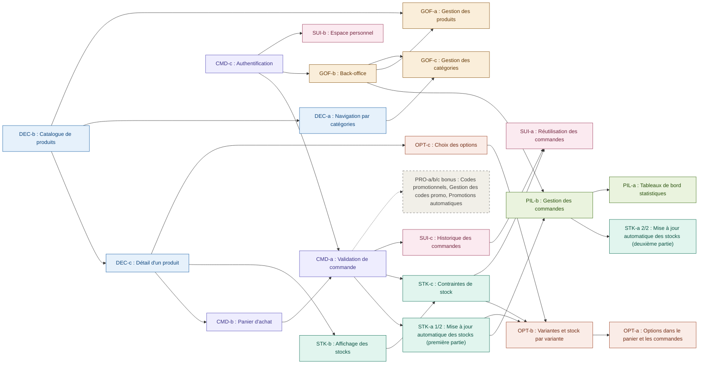

# Analyse des user stories : dépendances et ordre de réalisation

## 1. Décisions d'architecture qui conditionnent l'ordre

- **Schéma de BDD « variantes d'abord »**. Chaque produit a au moins une variante (une « variante par défaut » s'il n'a pas d'options), et le stock est porté par la variante. Les US STK-a/b/c sont donc écrites *par variante* dès le départ. Cela évite la migration lourde de code que prévoit OPT-b si on modélise le stock au niveau produit.
- **Panier et lignes de commande identifiés par `variantId`**, avec l'option choisie et le prix unitaire figé. OPT-a (options dans le panier) n'oblige alors pas à réécrire CMD-b ni CMD-a.
- **Validation de commande dans une transaction SQL dès CMD-a**. STK-a vient ensuite y brancher le décrément sans réécriture.
- **STK-a découpée en deux** : (1/2) décrément + journal + transaction, à la validation ; (2/2) recrédit à l'annulation, qui dépend de PIL-b.
- **Données de test (seeds) injectées dès le départ** : les US de lecture (DEC-*) ne dépendent donc pas de GOF-a (CRUD produits).

## 2. Tableau des dépendances

| US | Dépend de (dur) | Dépendances souples | Complexité |
|---|---|---|---|
| DEC-b Catalogue | seeds BDD | | 1 |
| DEC-c Détail produit | DEC-b | | 2 |
| DEC-a Navigation catégories | DEC-b | | 1 |
| CMD-c Authentification | schéma `users` | | 3 |
| CMD-b Panier | DEC-b, DEC-c | | 3 |
| CMD-a Validation commande | CMD-b, CMD-c | | 4 |
| GOF-b Back-office | CMD-c (hash + sessions réutilisés) | CMD-a (indicateurs commandes) | 3 |
| STK-b Affichage stock | DEC-c | | 1 |
| STK-a (1/2) Décrément + journal | CMD-a | | 5 |
| STK-c Contraintes de stock | STK-b, CMD-b, CMD-a | | 3 |
| PIL-b Gestion des commandes | CMD-a, GOF-b, STK-a (1/2) | | 4 |
| STK-a (2/2) Recrédit annulation | PIL-b | | 1 |
| OPT-c Choix des options | DEC-c | | 3 |
| OPT-b Variantes / stock par variante | OPT-c, STK-a, STK-b, STK-c | | 4 |
| OPT-a Options panier / commandes | OPT-b, CMD-b, CMD-a | | 3 |
| SUI-b Espace personnel | CMD-c | CMD-a (commandes récentes) | 2 |
| SUI-c Historique commandes | CMD-a, CMD-c | PIL-b (statuts), OPT-a (options) | 2 |
| GOF-a Gestion des produits | GOF-b, DEC-b | STK-b (seuil), OPT-b/OPT-c (options) | 4 |
| GOF-c Gestion des catégories | GOF-b, DEC-a | GOF-a | 2 |
| SUI-a Commander à nouveau | SUI-c, CMD-b, STK-c | OPT-a, GOF-a (produits supprimés) | 3 |
| PIL-a Statistiques | GOF-b, CMD-a, PIL-b | STK-a, STK-b (stocks faibles) | 4 |
| PRO-a Codes promo (bonus) | CMD-a | | 2 |
| PRO-b Gestion codes promo (bonus) | PRO-a, GOF-b | | 2 |
| PRO-c Promos automatiques (bonus) | STK-b, CMD-b | CMD-a (prix figé) | 2 |

## 3. Graphe des dépendances

## 4. Ordre de réalisation retenu
 
Chaque US est placée après toutes celles dont elle dépend dans le graphe (colonne « Dépend de »). Quand le graphe laisse plusieurs positions possibles, le choix est justifié par la valeur utilisateur, la complexité et le risque de reprise de code.
 
| Rang | US | Dépend de (graphe) | Justification |
|---|---|---|---|
| 0 | *Fondations* (hors US) | n/a | Dépôt GitHub, base de code fournie, schéma BDD complet (variantes, stock, commandes, journal), seeds, layout, tokens Figma. Un schéma pensé une fois évite les migrations. |
| 1 | **DEC-b** Catalogue | n/a | Racine du graphe : débloque DEC-c, DEC-a et GOF-a, donc presque toute la suite. Complexité 1, premier résultat visible. |
| 2 | **DEC-c** Détail produit | DEC-b | Nœud le plus central : débloque CMD-b, STK-b et OPT-c, soit trois branches. |
| 3 | **DEC-a** Catégories | DEC-b | Complexité 1, rapide à finir. Termine l'epic « Découvrir l'offre ». |
| 4 | **CMD-c** Authentification | n/a | Seconde racine, indépendante du catalogue. Débloque CMD-a, GOF-b et SUI-b. Hash et sessions faits une seule fois. |
| 5 | **CMD-b** Panier | DEC-c | Chemin critique. Construit avec `variantId` et prix figé pour éviter une reprise à OPT-a. |
| 6 | **CMD-a** Validation de commande | CMD-b, CMD-c | Termine le chemin critique : **jalon 1**, achat complet de bout en bout. Débloque STK-a, STK-c, SUI-c. Écrite dans une transaction dès le départ. |
| 7 | **GOF-b** Back-office | CMD-c | Ne dépend que de l'authentification déjà faite. Requis par PIL-b, GOF-a et GOF-c. |
| 8 | **STK-b** Affichage stock | DEC-c | Complexité 1. Ajoute les champs de stock par variante, requis par STK-c. |
| 9 | **STK-a (1/2)** Décrément + journal | CMD-a | US la plus risquée (complexité 5, test de concurrence), donc placée tôt pour garder du temps de correction. Débloque PIL-b et OPT-b. Se branche sur la transaction de CMD-a. |
| 10 | **STK-c** Contraintes de stock | CMD-a, STK-b | Empêche la survente. Requis par OPT-b et SUI-a. |
| 11 | **PIL-b** Gestion des commandes | STK-a (1/2), GOF-b | Statuts et annulation (complexité 4). Débloque STK-a (2/2) et PIL-a. |
| 12 | **STK-a (2/2)** Recrédit | PIL-b | Branché sur l'annulation, complexité 1. **Jalon 2** : stock et traitement des commandes cohérents. |
| 13 | **OPT-c** Choix des options | DEC-c | Placée après le stock pour que le schéma variantes soit déjà éprouvé. |
| 14 | **OPT-b** Variantes | OPT-c, STK-a (1/2), STK-c | Ses trois prérequis sont faits (rangs 9, 10, 13). Les règles de stock par variante existent déjà. |
| 15 | **OPT-a** Options panier / commandes | OPT-b | **Jalon 3** : epic « Personnaliser » terminé. |
| 16 | **SUI-b** Espace personnel | CMD-c | Complexité 2. Les commandes récentes se branchent sans reprise puisque CMD-a est faite. |
| 17 | **SUI-c** Historique | CMD-a | Faisable dès le rang 7, mais placée après PIL-b et OPT-a (choix) pour afficher statuts et options sans retoucher le code. |
| 18 | **GOF-a** Gestion des produits | DEC-b, GOF-b | Faisable dès le rang 7, mais placée après les options (choix) : le formulaire (options, variantes, seuil) est écrit une seule fois. |
| 19 | **GOF-c** Gestion des catégories | DEC-a, GOF-b | Complexité 2. Termine l'epic « Gérer l'offre » (**jalon 4**). |
| 20 | **SUI-a** Commander à nouveau | SUI-c, STK-c | Gère aussi les produits supprimés, testable grâce à GOF-a. Termine l'epic « Suivre mes achats ». |
| 21 | **PIL-a** Statistiques | PIL-b | Lecture seule sur des données finales, complexité 4 : en dernier (choix). **Jalon 5**. |
| 22 | **PRO-a, PRO-b, PRO-c** (bonus) | CMD-a | Seulement si tout le reste est propre. |
 
